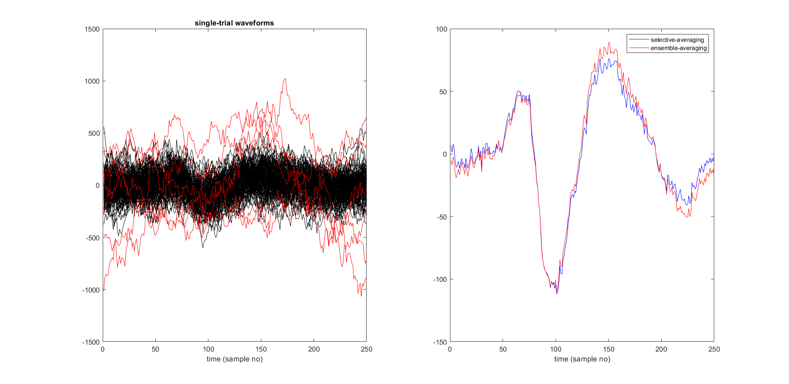

# Brain–computer interfaces and biomedical signal processing

MATLAB coursework from Spring 2025 on three questions: can single-trial MEG distinguish an auditory stimulus from spontaneous activity, how much do outlying trials affect a visual evoked response, and which intracranial EEG features distinguish recordings before and during a seizure? The repository includes the recordings, analysis scripts, figures, and two project reports.

## Analyses and results

| Analysis | Data and method | Recorded result |
| --- | --- | --- |
| [Auditory MEG classification](classification_of_MEG_responses_3.m) | Left and right auditory-cortex signals from one subject at 625 Hz. The script extracts stimulus-locked trials and matching control windows, filters at 3–20 Hz, and computes 10 time-domain, spectral, and wavelet features per hemisphere. | A linear SVM averaged **84.44% accuracy** across five stratified folds. Each fold uses its training mean and standard deviation to scale the held-out trials. [MEG report, p. 6](BCI_Project_1-Mandatory.pdf#page=6) |
| [Visual evoked potential (VEP) trial ranking](script_for_ranking_VEP_single_trials_1.m) | 110 trials of 250 samples at 1 kHz. After linear detrending, each trial is ranked by the sum of its Euclidean distances to the other trials. | Removing the six highest-ranked outliers raised single-trial signal-to-noise ratio (SNR) from **0.0950 to 0.1234**, a **29.83%** increase. For the first 50 trials, removing three raised SNR from **0.1199 to 0.1489**. [VEP report, p. 9](BCI_Project_1.pdf#page=9) |
| [Intracranial EEG and Hjorth descriptors](script_analyzing_epilepsy_data_using_Hjorth_descriptors_8.m) | Eight paired pre-ictal and ictal recordings. Each segment contains 76 channels × 4,000 samples at 400 Hz. Activity, mobility, and complexity give 228 features per segment. | The report gives **16/16** correct leave-one-out classifications with linear discriminant analysis, both for the five highest-ranked features and for the three features of sensor 29. The checked-in script runs the sensor-29 analysis by selecting the sensor containing the lowest-ranked feature. [iEEG report, p. 12](BCI_Project_1.pdf#page=12) |

The iEEG result describes these 16 segments. The script ranks features on the full dataset before cross-validation and holds out one segment at a time, so the paired segment from the same seizure remains in training. An evaluation on unseen seizures would hold out both segments together and repeat feature selection within each training fold.



## Run the MATLAB analyses

Open MATLAB in the repository root. The [data directory](data/) includes the recordings used by the scripts. Add it and its subfolders to the MATLAB path so the scripts can resolve their bare filenames. Run each script separately because each clears the workspace and closes open figures.

```matlab
addpath(genpath(fullfile(pwd, 'data')))
run('script_analyzing_epilepsy_data_using_Hjorth_descriptors_8.m')
```

| Script | Requirements and inputs |
| --- | --- |
| iEEG | Uses Bioinformatics Toolbox for `rankfeatures` and Statistics and Machine Learning Toolbox for `classify`. Loads the eight `sz*_pre.dat` / `sz*_ict.dat` pairs and prints the sensor rankings and leave-one-out accuracy. |
| Auditory MEG | Uses Signal Processing Toolbox, Wavelet Toolbox, and Statistics and Machine Learning Toolbox. Also requires the course helper `signal_to_trials.m` on the MATLAB path. That helper is absent from this checkout. The script expects one row per trial and sample offsets from −100 to +300 around each onset. |
| VEP | Uses Statistics and Machine Learning Toolbox for `pdist` and `squareform`. The supplied [SNR function](snr_sample.m) calls the course helper `dmatrix.m`, which is absent from this checkout. On case-sensitive systems, load the file using its exact name, `data/VEPS.MAT`. The calculation below reproduces the reported SNR without that helper. |

### Reproduce the VEP result

This calculation uses the [bundled VEP data](data/VEPS.MAT). The noise estimate is the mean across-trial sample variance over all time points, equivalent to the squared-distance formula in the report. The trial ranking itself uses ordinary Euclidean distances.

```matlab
data = load(fullfile('data', 'VEPS.MAT'), '-mat');
trials = detrend(double(data.veps).').';
distances = squareform(pdist(trials, 'euclidean'));
[~, order] = sort(sum(distances, 2), 'descend');
kept = trials(order(7:end), :);

noisePower = @(x) mean(var(x, 0, 1));
trialSNR = @(x) mean(mean(x, 1).^2) / noisePower(x) - 1 / size(x, 1);
before = trialSNR(trials);
after = trialSNR(kept);
fprintf('Single-trial SNR: %.4f -> %.4f (%+.2f%%)\n', ...
        before, after, 100 * (after / before - 1));
```

Expected output: `Single-trial SNR: 0.0950 -> 0.1234 (+29.83%)`. To reproduce the 50-trial comparison, use `data.veps(1:50, :)` before detrending and keep `order(4:end)` after ranking.

## Course materials

- [Assignment brief](SPBCI_Assignment_for_BrainSignalAnalytics_2024.pdf)
- [Auditory MEG methods, figures, and fold accuracies](BCI_Project_1-Mandatory.pdf)
- [VEP and intracranial EEG analyses](BCI_Project_1.pdf)
- [Original figure gallery](pics/)
